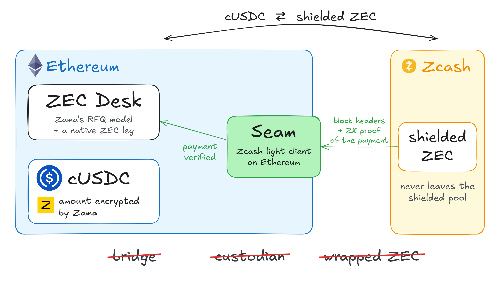
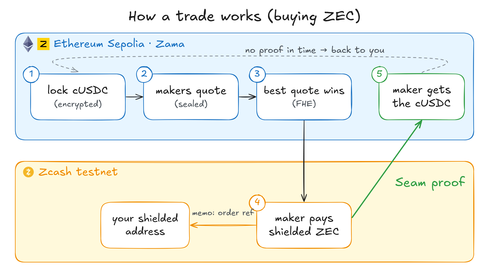
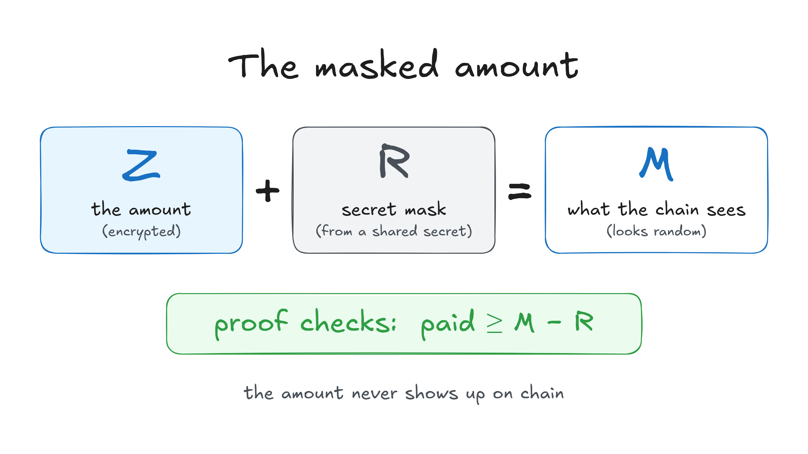

# ZEC Desk

Sealed-bid swaps between shielded ZEC and confidential USDC (cUSDC), with the amounts hidden on both chains. Makers bid
encrypted quotes on Ethereum Sepolia (Zama's FHEVM); the best bid at or above the user's encrypted minimum wins; the ZEC
moves as a shielded Ironwood payment on Zcash Testnet; a [Seam](https://github.com/Himess/seam) amount-hidden payment
proof releases the escrow. No custodian, no bridge, no multisig.

**Status: research prototype, testnets only, not audited.**

## How a Buy works

1. The user locks cUSDC and states, encrypted, its amount, the least ZEC it accepts, and a mask R derived from a fresh
   salt. Only a salted commitment of its Zcash address goes on chain.
2. Allowlisted makers decrypt the size (they price from it) and send encrypted quotes. The desk keeps a running best
   under FHE, in each maker's own transaction.
3. After the quote window the desk compares the best quote with the minimum under FHE and publishes only the winner and
   M = B + R. M looks random to everyone without the salt; the user learns its best quote as M − R.
4. The user hands its address and salt to the winning maker, off chain. The maker checks M against its own quote, pays
   the ZEC to that address with the order's memo, and proves the payment with Seam's amount-hidden guest.
5. The proof shows the payment paid at least M − R to the committed receiver, anchored on a Zcash header the Seam relay
   holds, before the deadline. After a few more Zcash blocks the desk pays the maker. Every failure path ends in a refund.

A Sell is the mirror: the maker locks its quote and gives its receiver commitment and mask; the user pays the ZEC and
either side proves it.

## The masked amount

Seam's original proof states the amount paid, and the ZEC amount times the price would give the dollar amount away. So
the desk adds an encrypted one-time mask R, derived from the receiver's salt and the order's reference, to the
encrypted amount, and decrypts only M = Z + R. The proof checks that the payment paid at least M − R and never states
the amount.

## What is public, what is hidden

| What | On Sepolia |
|---|---|
| Amounts (cUSDC, ZEC, the minimum, the bids) | encrypted; the ZEC amount appears only as the masked M |
| The Zcash address, the payment's txid and note | never; the address only as `keccak256(salt ‖ receiver)` |
| That an order exists, its direction, the EVM addresses, the winner, the timing of each step | public |

**Trust:** Zcash proof of work through the Seam relay; RISC Zero's proof system and router; Zama's key holders and
coprocessors; the desk's admin for the maker list.

## Repository

| Path | What |
|---|---|
| `contracts/` | `ZecDesk` and its two libraries `ZecDeskMatch` and `ZecDeskSettle` (DELEGATECALL, the desk's storage); Hardhat with Zama's FHEVM plugin |
| `maker/` | The market maker (Rust): encrypted quotes through Zama's Rust client and SDK daemon, the ZEC leg through Seam's CLI, the off-chain hand-off API |
| `app/` | Buy in the browser (Preact, ethers, `@fhevm/sdk`), modelled on a familiar swap card |
| `scripts/` | Sepolia keys, deployment, the scripted end-to-end runs, the gas report, the GPU session and a secret check |
| `results/` | What the runs measured: gas per step, the proof, the settlement |
| `media/x-post/` | The diagrams: PNGs and their Excalidraw sources (open a `.excalidraw` file at excalidraw.com to edit it) |

Comments that cite `docs/PHASE0-DESIGN.md` refer to the private working notes the design was made in; they are not in
this repository.

**MOCK** (labelled in code): `contracts/test/MockRelay.sol` and `MockMaskedVerifier.sol` (local tests only),
`contracts/test/NoProofStubs.sol` (a relay that knows no header and a verifier that refuses every proof, for throwaway
public-testnet runs without proofs), `TestConfidentialUSD` and the deployed test token tcUSD (public mint, no value).

## Live on Sepolia (12 November 2026)

| Contract | Address |
|---|---|
| Seam relay | `0xc85AC30c388C4eD645a4833Ebaa69EEFbB501235` |
| Its `ZcashEquihash` library | `0x42847B5C7a13abd1c9b0E61ea59E44f1EE1351aD` |
| Seam amount-hidden verifier | `0x321fFfA506893DA5Ac16c883FA3f32bdE3f1c22E` |
| ZecDesk | `0xBD24DDCa2d509efA2dBabC0d092bd07b2bD8415E` |
| Token (MOCK tcUSD) | `0xE552Beed2265a8666d25307079fad9eDA2D70172` |

The relay's checkpoint is Zcash Testnet block 4,611,400. The verifier pins the guest `payment-masked-test`
(`0x482f76d7…bc7f`) and checks proofs through RISC Zero's router (selector `0xe71e6620`). The desk's proving window is
7 days.

The first order, a Buy of 1.2 cUSDC, ran end to end: one maker quoted encrypted; the desk matched it at 0.02985 ZEC
(the user reads it as M − R); the user handed its address to the maker; the maker paid it shielded on Zcash Testnet
(block 4,611,452), anchored at 4,611,453 with 19.9 million work on top. Its amount-hidden proof was made once, on a
rented RTX 4090; [`proveSettlement`](https://sepolia.etherscan.io/tx/0xd1981fb6d92c9827646d3d3f1594a302b77888ef550f811df040321c2d6c8ad2)
accepted it, and after six more Zcash headers the maker's
[`finalizeSettlement`](https://sepolia.etherscan.io/tx/0x278206a1fb1794f234c69e54c076ecbec66300cb39970cd07120fb4f6057271f)
paid it the escrowed cUSDC: Settled. The record is [`results/proof-b2e2b26f.json`](results/proof-b2e2b26f.json).

## The proof (one GPU session, 12 November 2026)

| Step | Measured |
|---|---|
| The guest, in the executor | 19,881,762 cycles in 21 segments of 2^20 |
| The succinct (STARK) receipt, on the GPU | 30.4 s |
| Its Groth16 wrap, on the same machine | 91.1 s; the seal is 260 bytes (the router's selector and the proof) |
| The machine | a rented RTX 4090 (24 GB; 30 vCPU, 48 GB of RAM), $0.57 an hour |
| The session | about 25 minutes with the setup, about $0.25 |

[`scripts/gpu-day.sh`](scripts/gpu-day.sh) runs it on the rented machine from Seam's source, the pinned guest and the
payment's witness, checks the image id, proves, and shreds the witness; the machine is destroyed afterwards. That VM
had the NVIDIA driver but no CUDA compiler, so CUDA 12.8's compiler packages went in first.

## Measured on Sepolia (12 November 2026)

Sepolia runs Glamsterdam: new storage slots and contract code cost far more than on mainnet today (code about 1,560 gas
a byte), and one transaction may use at most 2^24 gas. Gas, not fees:

| Step | Gas |
|---|---|
| Deploy `ZecDesk` / `ZecDeskMatch` / `ZecDeskSettle` | 16,001,641 / 9,703,770 / 11,634,870 |
| Allowlist a maker | 351,290 |
| `openBuy` (lock cUSDC, three encrypted inputs, snapshot the makers) | 3,714,863 |
| `quote` (one maker's encrypted bid, the running best) | 713,342 |
| `resolve` (best ≥ minimum under FHE, M = B + R) | 979,097 |
| `publishBuyResolution` (the KMS proof checked on chain) | 620,620 |
| `proveSettlement` (the Groth16 proof through RISC Zero's router, the journal against the order) | 547,360 |
| `finalizeSettlement` (six headers and 150 s later; pays the escrow) | 1,074,376 |
| A whole Buy, `openBuy` to `finalizeSettlement` (the first order's six transactions) | 7,649,658 |
| The relay: eight Zcash headers in one transaction | 8,221,506 (about 1.03 million a header) |
| `openSell` (two encrypted inputs, snapshot the makers) | 2,365,810 |
| `quote` / `resolve` / `publishSellResolution` on a Sell | 713,322 / 613,487 / 507,673 |
| `fund` (the maker locks its quote, gives its commitment and mask) | 2,222,893 |
| `publishFunding` (funded and M, with the KMS proof) | 508,914 |

A Buy took about 4 minutes from opening to its match; a Sell about 4 minutes from opening to its funding. The maker
ran on a small server, its FHE through Zama's SDK daemon (Rust client), on 12 November 2026.

## Where the cost is

The swap itself is affordable even on Ethereum: an order's FHE operations and its proof's verification. What is
expensive on L1 is the relay that keeps Zcash's headers on chain: since NU7 Zcash makes a block every 25 seconds, 3,456
headers a day. A header costs about 626,000 gas on Base Sepolia (Seam's measurement) and about 1.03 million on
Ethereum Sepolia, which runs Glamsterdam's storage pricing (eight in one transaction, above): some 2.2 to 3.5 billion
gas a day. On Base the same relay costs about 0.012 ETH a day. Two ways out, both Seam's: run the relay where gas is cheap, or prove headers
in batches in a zkVM so the relay checks one proof for many headers (on Seam's roadmap).

## Where it can run

The desk is its own contract: it needs Zama's FHEVM, a confidential USDC (cUSDC) and an EVM where Seam runs (the BLAKE2b
precompile and RISC Zero's verifier router). It doesn't need Zama's own swap on that chain.

- **Ethereum Sepolia:** today (this prototype).
- **Base:** Seam's relay already runs on Base Sepolia; if Zama comes to Base, the desk can use it as is.
- **Polygon PoS:** RISC Zero's router is deployed and the BLAKE2b precompile works; Zama's FHEVM and confidential tokens
  there are to be confirmed against Zama's own documentation. Polygon's testnet (Amoy) has no RISC Zero router.
- **Solana:** a separate project: Seam is written for the EVM.

## License

MIT
